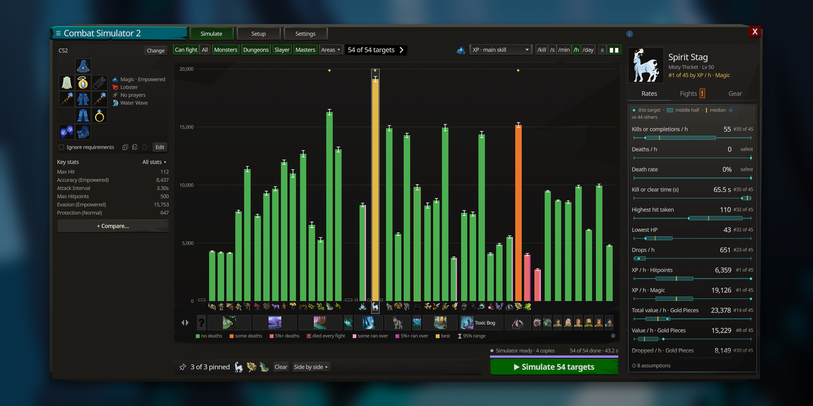
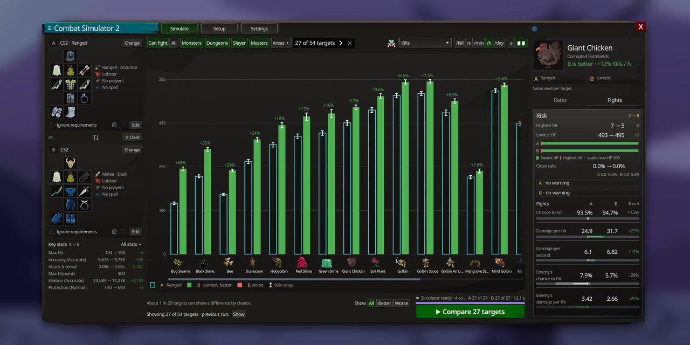
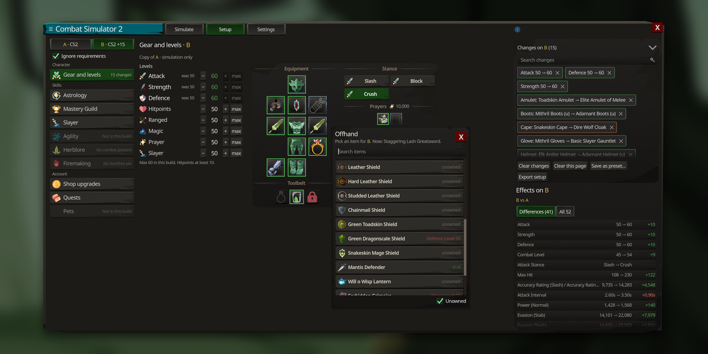
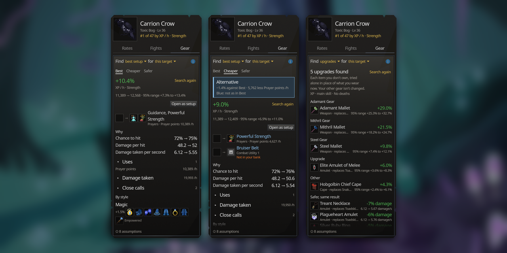
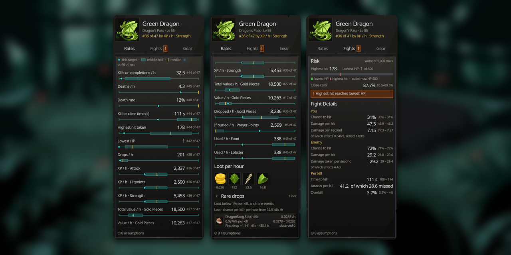
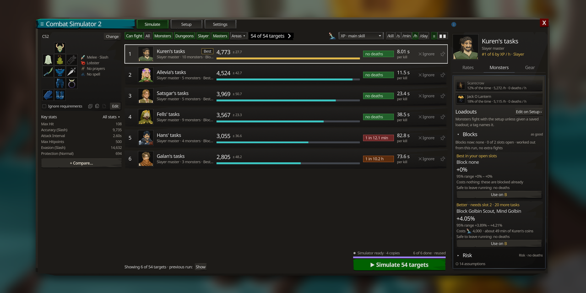

# Combat Simulator 2

A combat simulator mod for Melvor Idle 2. It runs each fight many times with the game's own combat code, on a copy of your character, so its numbers follow the game as it would play.

Screenshots

**Results**: every target ranked by XP, kills and more, with deaths per hour.

**Compare**: two setups on the same fights, side by side.

**Setup**: try any gear, levels, prayers, potions, pets and more, owned or not.

**Best setup**: the best gear for a target, a cheaper option, and the upgrades worth chasing.

**Rare drops**: the chance per kill, and roughly when the first one should drop.

**Slayer masters**: the best loadout for each master, and which tasks to block.

## Install

1. Close Melvor Idle 2.
2. Download the zip from [Releases](../../releases) and extract everything into the game's folder, next to `Melvor2.exe` (in Steam: right-click the game, Manage, Browse local files). Replace files if asked.
3. Start the game and open the simulator with **Sim** in the game's header.

## Update

Close the game and extract the new zip over the old files. Your settings and saved runs stay.

## Uninstall

Close the game and delete `mods/CombatSimulator2/` in the game's folder; its settings and saved runs go with it. If no other mod is installed this way, also delete `winmm.dll` and the `mods/` folder.

## What it installs

- `winmm.dll` next to `Melvor2.exe`, which starts the mod.
- `mods/CombatSimulator2/`: the mod, its loader (`loader/`), and its settings, saved runs, logs and bug reports.

Fights run in a hidden second copy of the game that closes with it. CS2 never changes your game or saves, and sends nothing online. Windows only.

## Bug reports

**Save bug report** in CS2's About writes a zip with CS2's logs and settings, your recent runs and your character's save (leave the save out in Settings). Attach it to your report:

- [Report a bug](../../issues/new?template=bug-report.yml) on GitHub
- [#mod-bug-reports](https://discord.com/channels/625838709203271680/1029950790254731334) on the Melvor Idle Discord

## Feedback

Ideas, or issues that aren't bugs: [send feedback](../../issues/new?template=feedback.yml).

## Translations

Help translate on [Crowdin](https://crowdin.com/project/combat-simulator-2), or [request a language or report a mistake](../../issues/new?template=translation.yml).

## Disclaimer

Unofficial fan mod, not affiliated with or endorsed by Games by Malcs or Jagex. Built with AI assistance.
